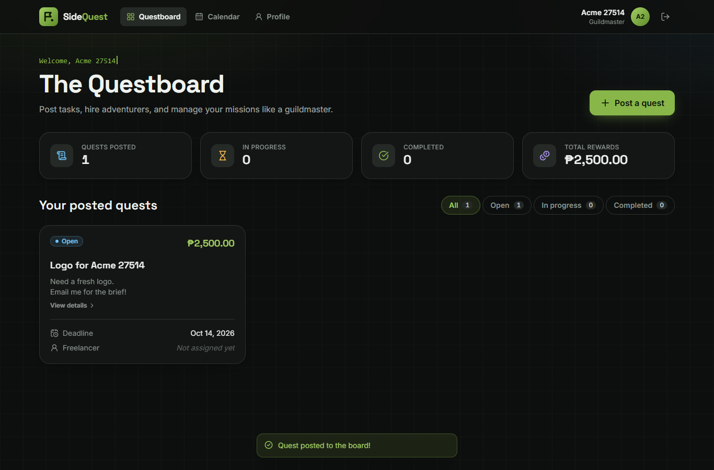
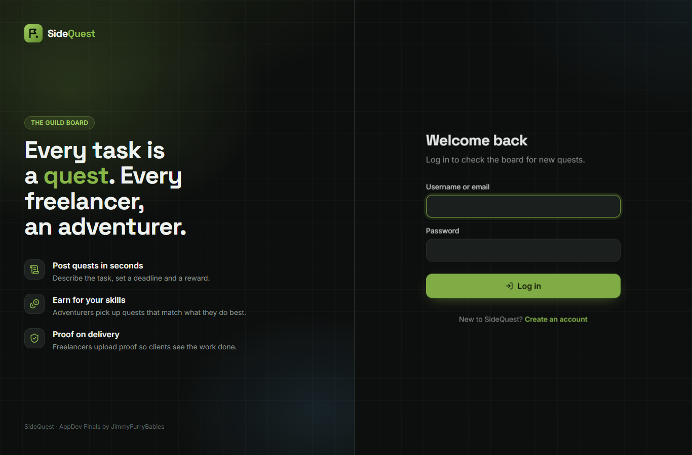
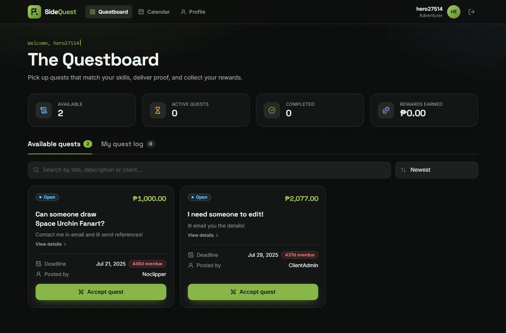
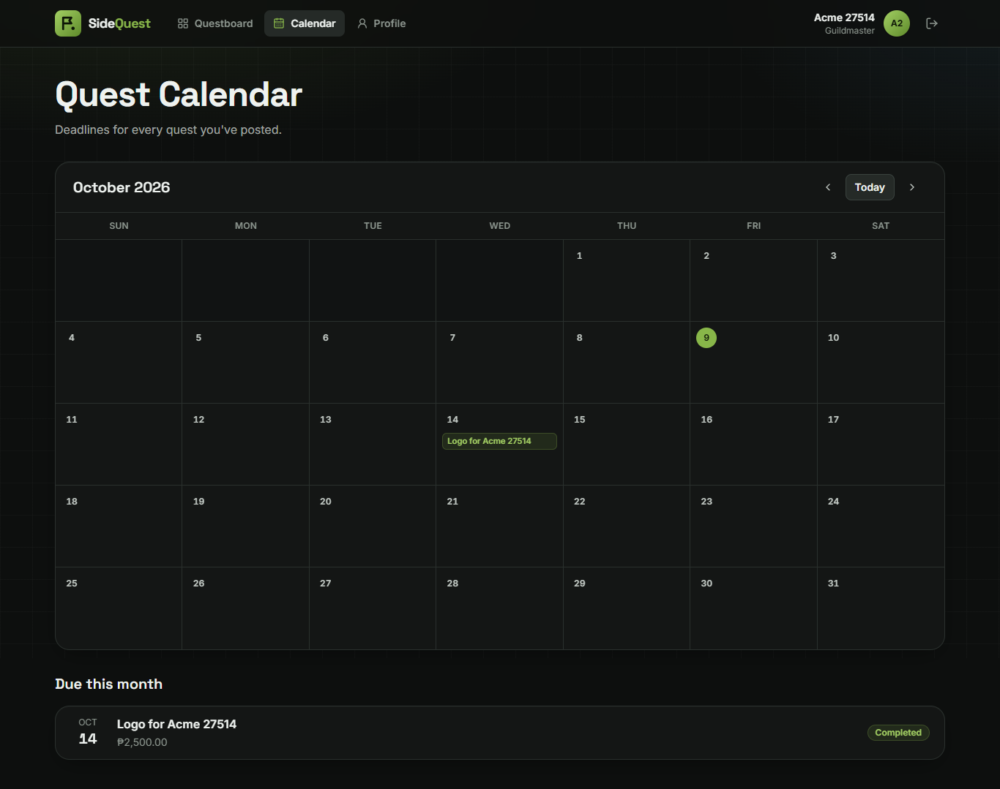
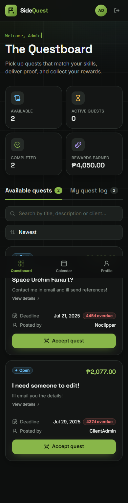

# SideQuest

SideQuest — our group's AppDev final project, remastered. A quest board where clients post tasks and freelancers take them on, reworked from PHP into Next.js with Supabase and a modern UI.



## About

Every task is a **quest** and every freelancer is an **adventurer**. Clients (guildmasters) post quests with a deadline and a reward. Freelancers browse the board, accept a quest, track their progress, and upload proof of the finished work for the client to review.

SideQuest started as our AppDev finals project, built with PHP and MySQL. This version is a full rework:

| | Original | Remastered |
| --- | --- | --- |
| Framework | Plain PHP pages | Next.js 16 (App Router) + React 19 + TypeScript |
| Styling | Inline CSS per page | Tailwind CSS 4 design system, responsive down to phone size |
| Database | MySQL on XAMPP | Supabase (PostgreSQL) |
| File uploads | Local `uploads/` folder, public to anyone with the link | Private Supabase Storage bucket, visible only to the quest's client and freelancer |
| Sessions | PHP sessions | Signed, HTTP-only session cookies |

The original PHP version is kept in [`legacy-php/`](legacy-php/) for reference.

## Features

- **Accounts:** register as a freelancer, an individual client, or a business. Log in with your username or email.
- **Client Questboard:** post quests, see your stats at a glance, filter by status, and open the proof a freelancer uploaded.
- **Freelancer Questboard:** search and sort open quests, accept one, move it through *Accepted → In progress → Completed*, and upload proof (images or PDF, up to 10 MB).
- **Calendar:** a month view of your quest deadlines.
- **Profile:** your account and contact details.

## Screenshots

| Login | Freelancer Questboard |
| --- | --- |
|  |  |

| Calendar | Mobile |
| --- | --- |
|  |  |

## Getting started

You need [Node.js](https://nodejs.org) 20.9 or newer and a free [Supabase](https://supabase.com) account.

### 1. Set up Supabase

1. In the [Supabase dashboard](https://supabase.com/dashboard), create a **New project**. Save the database password you choose.
2. Open **SQL Editor** → **New query**. Paste in [`supabase/migrations/20261009000000_init.sql`](supabase/migrations/20261009000000_init.sql) and click **Run**. This creates the tables, locks them down with row-level security, and creates the private `proofs` storage bucket.
3. *(Optional)* Run [`supabase/seed.sql`](supabase/seed.sql) the same way to load the sample accounts and quests from the original database.

### 2. Add your environment variables

Copy `.env.example` to `.env.local` and fill it in:

| Variable | Where to find it |
| --- | --- |
| `DATABASE_URL` | Click **Connect** at the top of the dashboard → **Direct** → **Transaction pooler**. Replace `[YOUR-PASSWORD]` with your database password. |
| `SUPABASE_URL` | Your project URL: `https://<project-id>.supabase.co`. The project ID is under **Project Settings → General**. |
| `SUPABASE_SERVICE_ROLE_KEY` | **Project Settings → API Keys → Secret keys**. This key is server-only: never commit it or use it in client code. |
| `SESSION_SECRET` | Any long random string: `node -e "console.log(require('crypto').randomBytes(32).toString('hex'))"` |

`.env.local` is git-ignored, so your keys stay on your machine. If `SUPABASE_URL` and `SUPABASE_SERVICE_ROLE_KEY` are left empty, proof uploads are saved to a local `uploads/` folder instead.

### 3. Run it

```bash
npm install
npm run dev
```

Then open http://localhost:3000.

For a production build, run `npm run build` and then `npm start`. To put the site online, import this repo on [Vercel](https://vercel.com/new) and add the same four environment variables there.

## Project structure

```
src/
  app/
    (auth)/            login, role picker, freelancer and client registration
    (app)/             signed-in pages: client and freelancer Questboards, calendar, profile
    uploads/[...path]  serves proof files to the quest's client and freelancer only
  actions/             server actions: auth, posting and accepting quests, progress updates
  components/          UI building blocks (quest cards, dialog, navigation, form fields)
  lib/                 database client, storage, sessions, queries, validation, formatting
  proxy.ts             sends signed-out users to login and keeps each role on its own pages
supabase/              database schema (migrations/) and sample data (seed.sql)
database/sidequest.sql the original MySQL dump, kept for reference
legacy-php/            the original PHP version
```

## Team

Made with tears and love by the group **JimmyFurryBabies**.

- **Project Lead:** Sean Kenly Dela Pena
- Balitayo, Jimiel
- Baranda, Darryl
- Rodriguez, Justine Gabriel
